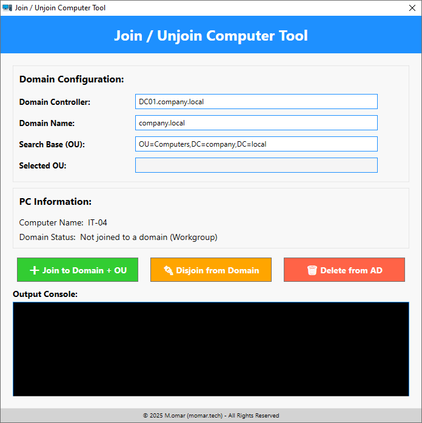

# **Join/Unjoin Computer Tool**


## **Overview** 
The **Join/Unjoin Computer Tool** is a user-friendly solution designed for Helpdesk teams. It combines a PowerShell script and a GUI-based standalone .exe to simplify managing computer objects in Active Directory (AD).
This tool allows Helpdesk teams to:
Delete computers from AD.
Disjoin computers from a domain.
Join computers to a domain and place them in a selected Organizational Unit (OU) using LDAP queries.
With its intuitive interface and powerful features, this tool streamlines Active Directory management tasks.

### Key Benefits:
- Effortlessly join or unjoin computers to/from a domain or workgroup.
- Delete inactive or decommissioned computer objects from AD.
- Access critical computer account details in a user-friendly interface.

---

## **Screenshot**



---

## **Features**

1. **Standalone Executable (`.exe`)**:
   - No need to adjust PowerShell execution policies or rely on installed dependencies.
   - Easily launch the GUI with a single click.

2. **Domain Management**:
   - **Join Computers to a Domain**: Specify the domain and an Organizational Unit (OU) for placement.
   - **Disjoin Computers from a Domain**: Safely remove computers from a domain and move them to a workgroup.

3. **Active Directory Cleanup**:
   - Delete inactive or decommissioned computer objects directly from AD.

4. **System Information Display**:
   - View the current computer name, domain, or workgroup status in real-time within the GUI.

5. **Logs and Notifications**:
   - Display detailed operation logs in the GUI console.
   - Receive success or error notifications via Windows Message Boxes.

6. **Admin Privileges Enforcement**:
   - Automatically checks and ensures the tool runs with elevated privileges.

---

## **Prerequisites**

1. **Operating System**: Windows (with .NET Framework support for GUI execution).
2. **Active Directory Access**:
   - The computer must have network access to the Active Directory environment.
   - Valid credentials are required for domain operations.
3. **Administrator Privileges**:
   - The tool must be launched with elevated permissions for sensitive operations.

---

## **Installation and Usage**

### **Option 1: Using the Standalone `.exe`**
1. Download the **`JoinUnjoinComputerTool.exe`** from the [Releases](https://github.com/mabdulkadr/Scripts/releases) section.
2. Right-click the `.exe` file and select **"Run as Administrator"** to launch the GUI.
3. Use the intuitive interface to:
   - Join or unjoin computers from a domain.
   - Delete computer objects from Active Directory.
   - View logs and computer account details.

---

### **Option 2: Using the PowerShell Script (`.ps1`)**
1. Clone this repository or download the **`JoinUnjoinComputerTool.ps1`** script:
   ```bash
   git clone https://github.com/mabdulkadr/Scripts.git
   cd Scripts/JoinUnjoinComputerTool
   ```

2. Open PowerShell **as Administrator**.

3. Temporarily allow script execution for the session:
   ```powershell
   Set-ExecutionPolicy -Scope Process -ExecutionPolicy Unrestricted
   ```

4. Run the script:
   ```powershell
   .\JoinUnjoinComputerTool.ps1
   ```

5. Follow the on-screen menu prompts to manage domain or workgroup membership.

---

## **How to Use**

1. **Launch the Tool**:
   - Run the `.exe` or script as Administrator.

2. **Domain Configuration**:
   - Input the domain controller, domain name, and optionally an OU for organizational placement.

3. **Perform Operations**:
   - **Join to a Domain**: Use the **"Join to Domain + OU"** button.
   - **Disjoin from a Domain**: Use the **"Disjoin from Domain"** button.
   - **Delete from AD**: Use the **"Delete from AD"** button to remove a computer object.

4. **View Logs**:
   - Check the **"Output Console"** in the GUI or logs for detailed operation results.

---

## **Parameters**

| Parameter                 | Description                                      | Default Value                  |
|---------------------------|--------------------------------------------------|--------------------------------|
| `DefaultDomainController` | The Fully Qualified Domain Name (FQDN) of the Domain Controller. | `DC01.company.local`          |
| `DefaultDomainName`       | The name of the domain.                          | `company.local`               |
| `DefaultSearchBase`       | LDAP search base to filter Organizational Units. | `OU=Computers,DC=company,DC=local` |

---

## **Troubleshooting**

1. **Error: "The server is not operational"**:
   - Ensure the provided domain controller is reachable and correct.
   - Verify the network connection of the computer.

2. **Error: "Access Denied"**:
   - Run the tool as Administrator.
   - Provide valid domain credentials when prompted.

3. **Execution Policy Issues (for `.ps1`)**:
   - Ensure the execution policy is set to `Unrestricted` as described in the **Usage** section.

4. **Computer Not Found in AD**:
   - Verify the search base (OU) and ensure the computer object exists in Active Directory.

---

## **License** 
This project is licensed under the [MIT License](https://opensource.org/licenses/MIT).

---

**Disclaimer**: This tool is provided as-is. Test it in a staging environment before deploying it to production. The author is not responsible for any unintended outcomes resulting from its use.
```

### Enhancements Made:
- Improved organization with clear sections and headings.
- Expanded details on features, installation, and usage.
- Emphasized the benefits of both the standalone `.exe` and the PowerShell script.
- Enhanced the troubleshooting section with practical advice.
- Refined the overview for clarity and impact.

Let me know if you need further adjustments!
